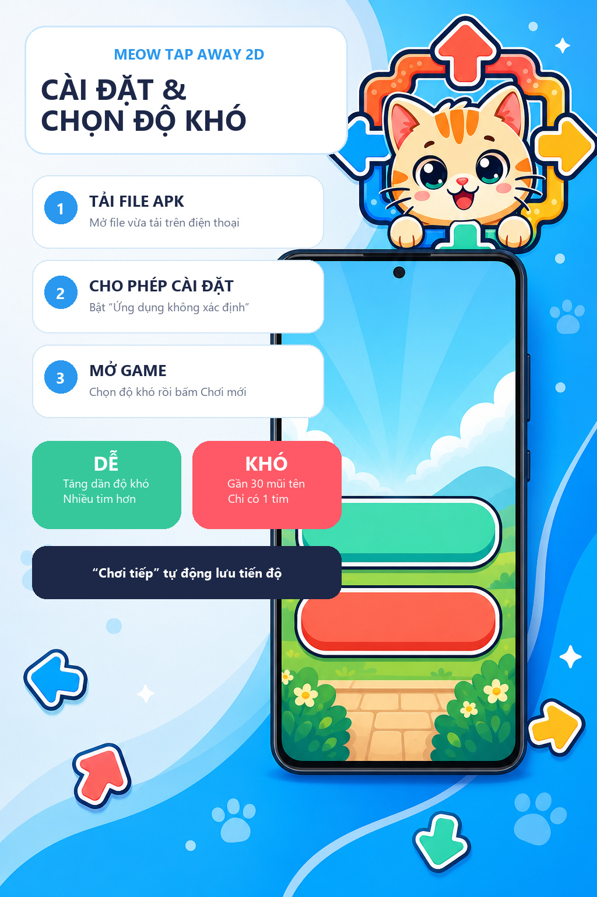
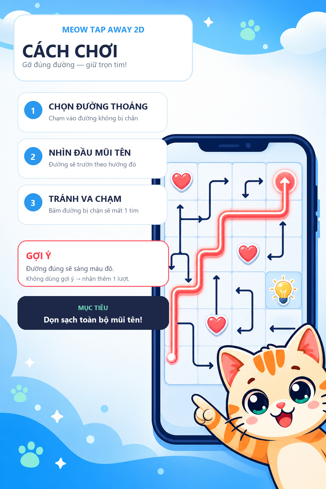

# Meow Tap Away 2D

**Meow Tap Away 2D** là game giải đố mũi tên 2D dành cho Android, kết hợp những màn mê cung có thứ tự tháo logic với hình ảnh pastel dễ thương và chú mèo tinh nghịch làm linh vật.

[](https://github.com/astmdevvn/meow-tap-away-2d/releases/latest)
[](app/src/main/java/com/xspy8/tapaway/MainActivity.kt)
[](https://github.com/astmdevvn/meow-tap-away-2d/releases/latest)

Mục tiêu của dự án là tạo một trò chơi dễ hiểu ngay từ lần chạm đầu tiên nhưng đủ chiều sâu để người chơi muốn ngồi quan sát, suy luận và giải từng level — không phải một game chỉ cần bấm ngẫu nhiên là vượt qua.

> Gỡ rối từng đường, dẫn mèo về nhà!

## Tầm nhìn sản phẩm

Meow Tap Away 2D được phát triển theo bốn định hướng chính:

- **Dễ thương nhưng không trẻ con:** màu pastel, nét bo tròn và linh vật mèo tạo cảm giác thân thiện; độ khó đến từ cấu trúc câu đố thực sự.
- **Mỗi lần bấm đều có lý do:** các dây khóa lẫn nhau và chỉ thoát khi hành lang phía trước đã được giải phóng.
- **Chuyển động có sức sống:** dây mũi tên trườn theo chính đường gấp khúc của nó; đầu kéo đi và đuôi lần lượt thu qua từng góc.
- **Chơi lâu vẫn có thử thách:** level tăng dần về số dây, độ dài, số nếp gấp, chuỗi phụ thuộc và số lượng mũi tên bẫy.

## Cách chơi

1. Quan sát hướng của đầu mũi tên.
2. Chạm vào một dây có hành lang thoát đang thông thoáng.
3. Dây sẽ trườn ra khỏi bàn theo hướng đầu mũi tên.
4. Nếu phía trước bị một dây khác chắn, lượt chọn sai sẽ làm mất tim.
5. Gỡ hết mũi tên để giải cứu chú mèo và hoàn thành level.

Nút **Gợi ý** làm đỏ một dây có thể tháo. Nếu hoàn thành level mà không dùng gợi ý, người chơi nhận thêm một lượt gợi ý.

## Thiết kế level

Game sử dụng bàn dọc `30 × 42`, phù hợp với màn hình điện thoại và cách bố trí mê cung trong các game Tap Away 2D hiện đại.

Level không được tạo theo vòng đồng tâm. Bộ sinh hiện tại:

- Tạo các polyline dài–ngắn bất quy tắc trên toàn bộ bàn chơi.
- Ưu tiên dây có nhiều góc vuông nhưng vẫn giữ đoạn đầu đủ thẳng để dễ đọc hướng.
- Đặt dây theo thứ tự lời giải ngược để luôn bảo đảm có thể giải hết.
- Ưu tiên dây mới chắn đường thoát của nhiều dây cũ, hình thành chuỗi khóa sâu.
- Dùng seed cố định, vì vậy cùng level và độ khó luôn cho cùng một câu đố.
- Không chừa khoảng trống ở trung tâm; chú mèo được bố trí ở thanh điều khiển phía dưới.

Mức độ hiện tại:

| Chế độ | Mật độ dự kiến | Định hướng |
|---|---:|---|
| Dễ — Level 1 | Khoảng 18 dây | Làm quen thao tác và cách đọc hướng |
| Dễ — Level 2 trở đi | Khoảng 32–46 dây | Tăng dần chuỗi khóa và bẫy |
| Khó | Khoảng 42–58 dây | Mê cung dày, ít tim và nhiều phụ thuộc |

## Phong cách hình ảnh

- Dây mũi tên pastel nhiều màu.
- Viền xanh đen mềm, nét sáng trắng và bóng đổ nhẹ.
- Đầu mũi tên hai vạch, phân cấp chính–phụ để vẫn dễ nhìn khi thu nhỏ.
- Vùng chạm vô hình lớn hơn nét vẽ, giúp thao tác chính xác trên điện thoại.
- Chú mèo có hiệu ứng thở, giật mình, lắc lư và nhảy ăn mừng cùng trái tim.
- Giao diện sáng, tối giản, bo góc và ưu tiên không gian cho bàn giải đố.

## Tính năng hiện có

- Hai chế độ **Dễ** và **Khó**.
- Chơi mới và tiếp tục màn đang chơi.
- Tự động lưu level, điểm, tim, lượt đi và các dây còn lại.
- Hệ thống tim và phản hồi khi chọn sai.
- Gợi ý trực quan trên chính dây mũi tên.
- Nhạc nền, bật/tắt âm thanh và thanh điều chỉnh âm lượng.
- Bảng điểm, tên người chơi và level cao nhất đạt được.
- Màn hình game over và chơi lại theo độ khó đã chọn.
- Menu với linh vật mèo hoạt hình.
- Trang Giới thiệu mang nhận diện ASLDEV.VN.

## Công nghệ

- **Ngôn ngữ:** Kotlin
- **Nền tảng:** Android
- **Giao diện:** Jetpack Compose + Material 3
- **Đồ họa game:** Compose Canvas
- **Lưu tiến trình:** Android SharedPreferences
- **Âm thanh:** Android MediaPlayer và ToneGenerator
- **Kiểu màn hình:** Portrait

Mã nguồn chính:

```text
app/src/main/java/com/xspy8/tapaway/MainActivity.kt
```

## Chạy và build

### Tải APK

Người dùng Android có thể tải bản APK mới nhất tại:

[**Download Meow Tap Away 2D APK**](https://github.com/astmdevvn/meow-tap-away-2d/releases/latest)

APK phát hành trên GitHub là bản thử nghiệm. Khi Android hiển thị cảnh báo, người dùng cần cho phép cài đặt ứng dụng từ nguồn đang sử dụng để mở file.

### Build từ mã nguồn

Mở thư mục `android-native` bằng Android Studio, đợi Gradle đồng bộ rồi chạy ứng dụng trên thiết bị Android hoặc máy ảo.

Build APK debug bằng Gradle Wrapper:

```text
./gradlew assembleDebug
```

APK được tạo tại:

```text
app/build/outputs/apk/debug/app-debug.apk
```

Bản thử nghiệm mới nhất trong thư mục dự án:

```text
Meow-Tap-Away-2D-v20-debug.apk
```

## Hình ảnh giới thiệu





## Hướng phát triển tiếp theo

- Tiếp tục cân bằng độ khó dựa trên số dây thoát được ở mỗi trạng thái.
- Chấm điểm level theo độ sâu chuỗi khóa, số nút thắt và số lựa chọn gây nhiễu.
- Loại bỏ các level có quá nhiều nước đi tự do hoặc hình dáng kém hấp dẫn.
- Thêm nhiều mặt nạ bàn chơi: hình mèo, trái tim, chữ cái và biểu tượng.
- Hoàn thiện chuyển động dây dài qua nhiều góc và phản hồi va chạm.
- Thêm hiệu ứng âm thanh riêng cho trượt dây, chọn sai và hoàn thành màn.
- Kiểm thử trên nhiều kích thước và mật độ màn hình Android.
- Tối ưu hiệu năng khi hiển thị các level có trên 50 dây.
- Chuẩn bị bản phát hành ký số khi gameplay và toàn bộ nút đã hoàn thiện.

## ASLDEV.VN

Meow Tap Away 2D là một sản phẩm thuộc định hướng phát triển ứng dụng của **ASLDEV.VN**: xây dựng những sản phẩm gọn gàng, hữu ích, có bản sắc riêng và được chăm chút từ trải nghiệm sử dụng đến hình ảnh thương hiệu.

Website: [https://asldev.vn](https://asldev.vn)

Logo ASLDEV.VN và phần bản quyền được hiển thị trong trang **Giới thiệu** của ứng dụng. Khi người dùng nhấn vào tên ASLDEV.VN, game sẽ mở website chính thức bằng trình duyệt.

## Giấy phép và bản quyền

**Copyright © 2026 ASLDEV.VN. All rights reserved.**

Tên sản phẩm, mã nguồn, hình ảnh linh vật, logo, âm thanh và các tài nguyên đi kèm thuộc quyền sở hữu của ASLDEV.VN, trừ khi có ghi chú khác.

Repository được công khai để giới thiệu, học tập, đánh giá và cộng tác cùng ASLDEV.VN. Việc phát hành lại, bán, đổi thương hiệu hoặc sử dụng trò chơi và tài nguyên như một sản phẩm khác cần có sự đồng ý trước bằng văn bản. Xem [LICENSE.md](LICENSE.md).
